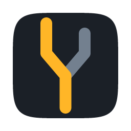

# displaymux

Switch a monitor's input source from the command line or the menu bar, over
DDC/CI.

`displaymux` is a small, native tool for desks where one monitor is shared by more
than one computer. Instead of reaching for the monitor's buttons, pick the input
from a menu — or script it.

```
DELL U2720Q
────────────────────────────────
0x0f  DisplayPort 1          switch
0x10  DisplayPort 2          switch
0x11  HDMI 1                 switch
0x12  HDMI 2                 switch
────────────────────────────────
4 inputs available
```

## Contents

- [Why another one](#why-another-one)
- [Platform support](#platform-support)
- [Building](#building)
- [Command line](#command-line)
- [Menu bar](#menu-bar)
- [How it works](#how-it-works)
- [Limitations](#limitations)
- [License](#license)

## Why another one

Most DDC/CI utilities either stop at one platform or expose only brightness and
contrast. displaymux focuses on **input selection**, the one thing you need when
two machines share a display, and it tries to be honest about what it cannot
know:

- **A switch is treated as a one-way command.** The UI never claims to know which
  input the display is on — see [Limitations](#limitations).
- **DDC is driven defensively.** On macOS a write can leave the I2C channel
  unusable for the remainder of the process, so writes run in a throwaway
  subprocess while reads share one long-lived process.
- **The GUI is native.** [GPUI](https://gpui.rs), no webview and no bundled
  browser runtime; roughly a 4 MB binary.

## Platform support

| Platform | Backend | Status |
|---|---|---|
| macOS (Apple Silicon) | private `CoreDisplay` / `IOAVService` via [`ddc-macos`](https://github.com/haimgel/ddc-macos-rs) | Works |
| macOS (Intel) | `IOFramebufferI2CInterface` | Untested |
| Windows | Monitor Configuration API (`dxva2`) | Works |
| Linux | `ddcutil` / `/dev/i2c-*` | Not implemented |

The Windows path needs no platform-specific code: `ddc-hi` already routes to
`ddc-winapi`, which covers enumeration, `GetVCPFeatureAndVCPFeatureReply`,
`SetVCPFeature` and `GetCapabilitiesString`. The CLI and helper build and run
there as they are. `build.rs` embeds `assets/icon.ico` into the executables,
since Windows takes a program's icon from a resource section rather than from a
file next to it.

> On macOS, DDC is unavailable through the built-in HDMI port on some models. A
> monitor attached over USB-C or DisplayPort is the reliable case.

## Building

Rust 1.99 or newer, pinned in `rust-toolchain.toml`.

```bash
# Command line tool and its DDC helper
cargo build --release --bin dmux --bin dmux-ddc-helper

# GUI and menu bar item
cargo build --release --features gui --bin dmux-gui
```

`dmux-ddc-helper` must sit next to `dmux`, be on `PATH`, or be pointed at with
`DMUX_DDC_HELPER`. Building both binaries into one target directory satisfies
that automatically.

The GUI sits behind the `gui` feature so the CLI stays cheap to build: GPUI brings
a large dependency tree that the DDC core does not need.

### Installing on macOS

`tools/bundle-macos.sh` builds all three binaries and assembles them into
`displaymux.app`, with the icon and an ad-hoc signature:

```bash
tools/bundle-macos.sh              # -> target/release/displaymux.app
tools/bundle-macos.sh --install    # also copies it to /Applications
```

All three binaries live in `Contents/MacOS`, which is what lets the GUI find
`dmux-ddc-helper` beside itself with no configuration. The command line tool is
then at `/Applications/displaymux.app/Contents/MacOS/dmux`; symlink it somewhere
on your `PATH` if you want it under the plain name.

The bundle is ad-hoc signed rather than notarised, so it runs locally but macOS
will warn if it is copied to another machine. Add `LSUIElement` to the
`Info.plist` the script writes if you would rather it were a pure menu bar app
with no Dock icon.

### Regenerating the icon

`assets/` is generated, not hand-drawn. `tools/make-icon.py` holds the geometry
and emits the SVG master, every PNG size, `icon.icns` and `icon.ico`:

```bash
python3 tools/make-icon.py
```

It needs one SVG rasteriser (`resvg`, `rsvg-convert` or `cairosvg`); `iconutil`
(macOS) and Pillow are used for the `.icns` and `.ico` when available. The menu
bar icon is not an asset — `src/tray.rs` rasterises the same geometry from a
signed distance field at runtime, so the menu bar, the app icon and this README
all show the same mark.

### A note on the GPUI dependency

The GUI builds against [`gpui-kit`](https://github.com/longbridge/gpui-kit), which
pins a matching family of `gpui-pre-*` crates and re-exports GPUI, `gpui-base`
and `gpui-component` behind one dependency:

```toml
gpui-kit = { version = "=0.7.3", default-features = false,
             features = ["component", "assets"], optional = true }
```

The version is pinned with `=` because gpui-kit pins its own `gpui-pre`
snapshot exactly; letting the minor drift would mix two incompatible GPUI trees.

Two features are load-bearing and gpui-kit already turns both on, but they are
worth knowing about because they are invisible when missing:

- **`font-kit`** belongs to GPUI's default feature set. Setting
  `default-features = false` on a raw GPUI dependency drops it, and the macOS
  backend then falls back to `NoopTextSystem`: layout, styling and font metrics
  all behave normally and **not one glyph is painted**. Zed hit the same trap in
  [zed-industries/zed#59241](https://github.com/zed-industries/zed/pull/59241).
  A quick check: `cargo tree -e normal | grep -c font-kit` returning `0` is the bug.
- **`runtime_shaders`** has GPUI compile its Metal shaders at run time. Without it
  the build calls `xcrun -sdk macosx metal`, which ships only with a full Xcode
  installation; with it, the Command Line Tools suffice.

Windows must be opened through `gpui_kit::open_window`, not `App::open_window`.
The helper wraps the view in `gpui_base::Root`; without that wrapper the app
compiles and runs, but the window collapses to a minimum size instead of using
the bounds it was given.

The cost of the layer is real: the GUI binary is about 15 MB against 7 MB on raw
GPUI. It is behind the `gui` feature, so the CLI and its DDC helper are unaffected.

## Command line

```
dmux list                              list DDC-capable displays
dmux status [--index=N] [--caps]       ports, capabilities and latency
dmux inputs [--index=N]                just the switchable inputs
dmux set <input> [--index=N]           switch input
dmux toggle [--index=N] [--to=<input>] switch to the next, or the given, input
dmux hold <input> [--index=N]          re-assert an input until it sticks
dmux bright <0-100> [--index=N]        set brightness
```

Inputs may be given as a VCP value (`0x11`, `17`) or by name with separators
ignored: `hdmi1`, `HDMI-1`, `dp2`, `displayport2`, `usbc1`.

```console
$ dmux status
display   : [0] DELL U2720Q
input     : 0x10 (DisplayPort 2)
switchable:
    0x0f     DisplayPort 1
  * 0x10     DisplayPort 2
    0x11     HDMI 1
    0x12     HDMI 2
latency   : 126 ms

$ dmux set hdmi1
switching [0] to 0x11 (HDMI 1) ...
result    : switch sent (monitor moved off this host, so no readback expected)
```

`dmux hold` re-sends the request on an interval, which helps when the monitor
would otherwise fall back to whichever input still carries a signal — for
example while the other machine is shutting down.

## Menu bar

Running `dmux-gui` installs a menu bar item. Closing its window does not quit the
app: the menu is the primary interface, and `Quit dmux` is how you leave.

The rows are the inputs the monitor advertises, and each one is an action. The
app never says which input the display is on now.

That is deliberate. There is no portable way to read a monitor's selected input
back:

* VCP `0x60` is the code that should report it, but implementations vary. Some
  monitors answer with the byte duplicated (`0x0f0f` for `0x0f`), some do not
  answer reads at all, and what a monitor does when asked from a *different*
  input than the one it is displaying is not defined by the DDC/CI spec.
* The value that does come back names the port in MCCS terms, which do not
  describe the physical connector. A monitor whose USB-C port carries
  DisplayPort alt-mode usually reports it as one of the DisplayPort values, so
  a row labelled "DisplayPort 2" may well be the socket labelled Type-C. There
  is no way to tell from DDC which is which.

A wrong "you are here" is worse than no answer, because it invites a switch that
leaves the user reaching for the monitor's buttons. So the tool stays a
switcher; the only thing it reports is the outcome of the command you just asked
for.

### Naming the ports

Because DDC cannot name the socket, you can. Labels live next to the app's other
config and are per display:

```bash
dmux label 0x10 "Type-C - Mac"    # write one
dmux labels                        # show the file and the resolved list
```

That writes `labels.json`, which is just a mapping:

```json
{
  "R32U81": {
    "0x0f": "DP - Windows",
    "0x10": "Type-C - Mac"
  }
}
```

Keys are the display id from `dmux list`, then the VCP `0x60` value. Codes are
compared in a canonical form, so `0x0F`, `0x0f` and `0xf` are the same key.
Anything unlabelled keeps its MCCS name, so the file can be partial or missing
entirely. Set `DMUX_LABELS` to point somewhere else.

## How it works

```
dmux-gui ─┐
          ├─→ displaymux::ddc ─→ dmux-ddc-helper ─→ ddc-hi ─→ platform API
dmux    ──┘        │
                   └─ timeouts, retries, switch verdict
                   displaymux::vcp ── VCP values and capabilities parsing
```

| Module | Responsibility |
|---|---|
| `vcp` | MCCS value naming, capabilities parsing, input specifier resolution |
| `ddc` | Subprocess management, timeouts, retries, and the switch verdict |
| `tray` | Menu bar item and menu |

`dmux-ddc-helper` performs exactly one DDC operation per invocation and exits.
That is not incidental: on macOS, issuing a write leaves the channel unusable for
further transactions from the same process, and a fresh process is the only
recovery. Reads are safe to share, so they use a persistent `serve` mode instead,
which also avoids paying process startup and device enumeration on every refresh.

The helper warms the channel up before its handshake, because the first
transaction on a freshly created handle reliably fails.

## Limitations

**A switch cannot be undone from the machine that issued it.** Once the display
moves to another computer, that computer drives it — and if the keyboard and
mouse are attached to the monitor's hub, they move with it. No hotkey can bring
the display back; the monitor's own input menu is the way. Treat a switch as a
deliberate, one-way action.

What the tool therefore does *not* do:

- It does not report which input the display is on. Some monitors return a
  constant value for VCP `0x60` regardless of the selected input, so the readback
  is not evidence. A wrong answer would be worse than none: it would aim a
  "switch back" command at the other computer.
- It does not verify that a switch happened. It reports that the monitor
  acknowledged the command, which is all the host can honestly know.
- It does not switch automatically.

If a switch lands on an input with no signal, some monitors hold that input and
display "no signal" rather than falling back. `tools/recover-input.sh` re-asserts
a given input from fresh processes, but it can only help while the DDC channel is
still alive.

## License

MIT — see [LICENSE](LICENSE).
